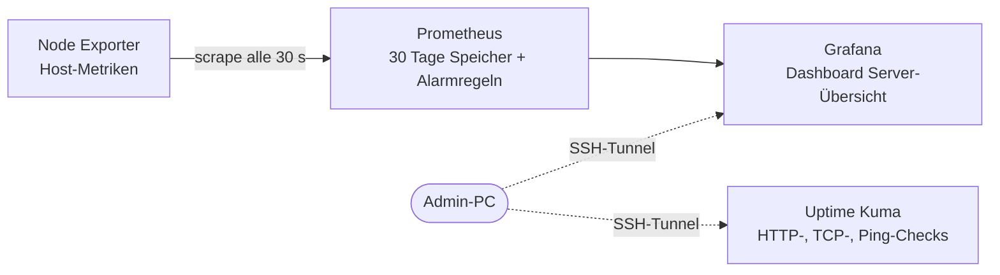

# Docker-Monitoring-Stack

[](https://github.com/eazzy1989/docker-monitoring-stack/actions/workflows/validate.yml)

Monitoring für einen Linux-Server mit **Docker Compose**: Metriken mit Prometheus und Node Exporter, Dashboards in Grafana und Erreichbarkeitsprüfungen mit Uptime Kuma. Läuft auf dem Ubuntu-Server in meinem [Homelab](https://github.com/eazzy1989/homelab) und ergänzt den [Ubuntu Guardian](https://github.com/eazzy1989/ubuntu-guardian): Der Guardian alarmiert per Telegram, dieser Stack zeigt Verläufe über Wochen.

## Komponenten



| Dienst | Aufgabe | Erreichbar |
|---|---|---|
| Prometheus | sammelt Metriken, wertet Alarmregeln aus | nur im Docker-Netz |
| Node Exporter | CPU, RAM, Festplatten, Netzwerk, Last des Hosts | Port 9100, per Firewall nur aus dem Docker-Netz |
| Grafana | Dashboard „Server-Übersicht“ (automatisch eingerichtet) | `127.0.0.1:3000` |
| Uptime Kuma | prüft Websites und Dienste, Statusseite | `127.0.0.1:3001` |

## Sicherheit

- **Keine Weboberfläche ist direkt im Netz.** Grafana und Uptime Kuma lauschen nur auf `127.0.0.1`. Docker veröffentlicht Ports sonst an der Host-Firewall (ufw) vorbei – so entsteht diese Lücke gar nicht erst.
- Zugriff per **SSH-Tunnel**, also nur mit SSH-Schlüssel (oder später über einen Reverse Proxy mit HTTPS).
- Grafana: Admin-Kennwort aus `.env` (nicht im Repo), Registrierung und Telemetrie aus.
- Datenquelle und Dashboard werden per **Provisioning** angelegt – nichts muss von Hand geklickt werden.

## Installation

Voraussetzung: Docker Engine mit Compose-Plugin.

```bash
sudo git clone https://github.com/eazzy1989/docker-monitoring-stack.git /opt/monitoring
cd /opt/monitoring
sudo cp .env.example .env
sudo sed -i "s|^GRAFANA_ADMIN_PASSWORD=.*|GRAFANA_ADMIN_PASSWORD=$(openssl rand -base64 24)|" .env
sudo chmod 600 .env

# Node Exporter nur aus dem Docker-Netz des Stacks erlauben
sudo ufw allow from 172.30.0.0/24 to any port 9100 proto tcp comment 'Node Exporter fuer Prometheus'

sudo docker compose up -d
sudo docker compose ps
```

Das Grafana-Kennwort steht danach in `.env` (`sudo cat /opt/monitoring/.env`).

## Zugriff

Vom eigenen Rechner aus:

```bash
ssh -L 3000:localhost:3000 -L 3001:localhost:3001 benutzer@server
```

Danach im Browser: Grafana unter <http://localhost:3000>, Uptime Kuma unter <http://localhost:3001>.

## Alarmregeln

| Regel | Bedingung |
|---|---|
| `ExporterNichtErreichbar` | ein Ziel liefert seit 2 Minuten keine Daten |
| `HoheCPULast` | CPU über 90 % für 10 Minuten |
| `WenigArbeitsspeicher` | RAM über 90 % für 10 Minuten |
| `FestplatteFastVoll` | weniger als 10 % frei für 15 Minuten |

Aktive Alarme sind in Prometheus unter *Alerts* sichtbar.

## Wartung

```bash
cd /opt/monitoring
sudo docker compose pull && sudo docker compose up -d   # Updates
sudo docker compose logs -f grafana                     # Logs
sudo docker compose down                                # stoppen (Daten bleiben in den Volumes)
```

## Automatische Prüfung

Bei jedem Push prüft GitHub Actions die Compose-Datei, die Prometheus-Konfiguration samt Alarmregeln (`promtool`) und die Dashboards.

## Lizenz

[MIT](LICENSE)
