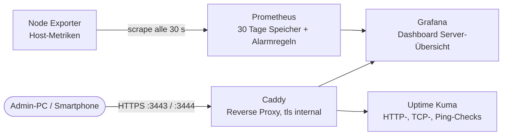

# Docker-Monitoring-Stack

[](https://github.com/eazzy1989/docker-monitoring-stack/actions/workflows/validate.yml)

Monitoring für einen Linux-Server mit **Docker Compose**: Metriken mit Prometheus und Node Exporter, Dashboards in Grafana und Erreichbarkeitsprüfungen mit Uptime Kuma. Läuft auf dem Ubuntu-Server in meinem [Homelab](https://github.com/eazzy1989/homelab) und ergänzt den [Ubuntu Guardian](https://github.com/eazzy1989/ubuntu-guardian): Der Guardian alarmiert per Telegram, dieser Stack zeigt Verläufe über Wochen.

## Komponenten



| Dienst | Aufgabe | Erreichbar |
|---|---|---|
| Prometheus | sammelt Metriken, wertet Alarmregeln aus | nur im Docker-Netz |
| Node Exporter | CPU, RAM, Festplatten, Netzwerk, Last des Hosts | Port 9100, per Firewall nur aus dem Docker-Netz |
| Grafana | Dashboard „Server-Übersicht“ (automatisch eingerichtet) | `127.0.0.1:3000` |
| Uptime Kuma | prüft Websites und Dienste, Statusseite | `127.0.0.1:3001` |

## Sicherheit

- **Keine Weboberfläche ist direkt im Netz.** Grafana und Uptime Kuma lauschen nur auf `127.0.0.1`. Docker veröffentlicht Ports sonst an der Host-Firewall (ufw) vorbei – so entsteht diese Lücke gar nicht erst.
- Zugriff im Heimnetz per **HTTPS über Caddy** (eigene Root-CA, Ports nur aus dem LAN freigegeben), als Fallback per **SSH-Tunnel** mit SSH-Schlüssel.
- Grafana: Admin-Kennwort aus `.env` (nicht im Repo), Registrierung und Telemetrie aus.
- Datenquelle und Dashboard werden per **Provisioning** angelegt – nichts muss von Hand geklickt werden.

## Installation

Voraussetzung: Docker Engine mit Compose-Plugin.

```bash
sudo git clone https://github.com/eazzy1989/docker-monitoring-stack.git /opt/monitoring
cd /opt/monitoring
sudo cp .env.example .env
sudo sed -i "s|^GRAFANA_ADMIN_PASSWORD=.*|GRAFANA_ADMIN_PASSWORD=$(openssl rand -base64 24)|" .env
sudo chmod 600 .env

# Node Exporter nur aus dem Docker-Netz des Stacks erlauben
sudo ufw allow from 172.30.0.0/24 to any port 9100 proto tcp comment 'Node Exporter fuer Prometheus'

sudo docker compose up -d
sudo docker compose ps
```

Das Grafana-Kennwort steht danach in `.env` (`sudo cat /opt/monitoring/.env`).

## Zugriff

### Im Heimnetz: HTTPS über Caddy

[Caddy](https://caddyserver.com/) läuft direkt auf dem Host und leitet zwei HTTPS-Ports an die Dienste weiter, die nur auf `127.0.0.1` lauschen. Mit `tls internal` stellt Caddy die Zertifikate über eine eigene Root-CA aus. Dafür braucht es weder eine Domain noch eine Portfreigabe am Router. Die Vorlage liegt in [`caddy/Caddyfile.example`](caddy/Caddyfile.example).

```bash
sudo apt install caddy
sudo cp caddy/Caddyfile.example /etc/caddy/Caddyfile        # oder die Blöcke an eine bestehende Caddyfile anhängen
sudo sed -i 's/SERVER_IP/192.0.2.10/g' /etc/caddy/Caddyfile # eigene LAN-IP eintragen
sudo systemctl reload caddy

# Die Ports nur aus dem Heimnetz erlauben
sudo ufw allow from 192.0.2.0/24 to any port 3443:3444 proto tcp comment 'Grafana und Uptime Kuma ueber Caddy'
```

Damit Browser und Smartphone keine Zertifikatswarnung zeigen, wird die Root-CA einmalig importiert. Sie liegt auf dem Server unter `/var/lib/caddy/.local/share/caddy/pki/authorities/local/root.crt`.

- **macOS:** `sudo security add-trusted-cert -d -r trustRoot -k /Library/Keychains/System.keychain root.crt`, danach den Browser neu starten.
- **iPhone:** Datei als Profil installieren, dann unter *Einstellungen → Allgemein → Info → Zertifikatsvertrauenseinstellungen* aktivieren.

Danach sind Grafana unter `https://192.0.2.10:3443` und Uptime Kuma unter `https://192.0.2.10:3444` erreichbar.

### Fallback: SSH-Tunnel

Falls Caddy nicht läuft, geht der Zugriff weiterhin vom eigenen Rechner aus:

```bash
ssh -L 3000:localhost:3000 -L 3001:localhost:3001 benutzer@server
```

Grafana ist dann unter <http://localhost:3000> erreichbar, Uptime Kuma unter <http://localhost:3001>.

## Alarmregeln

| Regel | Bedingung |
|---|---|
| `ExporterNichtErreichbar` | ein Ziel liefert seit 2 Minuten keine Daten |
| `HoheCPULast` | CPU über 90 % für 10 Minuten |
| `WenigArbeitsspeicher` | RAM über 90 % für 10 Minuten |
| `FestplatteFastVoll` | weniger als 10 % frei für 15 Minuten |

Aktive Alarme sind in Prometheus unter *Alerts* sichtbar.

## Wartung

```bash
cd /opt/monitoring
sudo docker compose pull && sudo docker compose up -d   # Updates
sudo docker compose logs -f grafana                     # Logs
sudo docker compose down                                # stoppen (Daten bleiben in den Volumes)
```

## Automatische Prüfung

Bei jedem Push prüft GitHub Actions die Compose-Datei, die Prometheus-Konfiguration samt Alarmregeln (`promtool`) und die Dashboards.

## Lizenz

[MIT](LICENSE)
